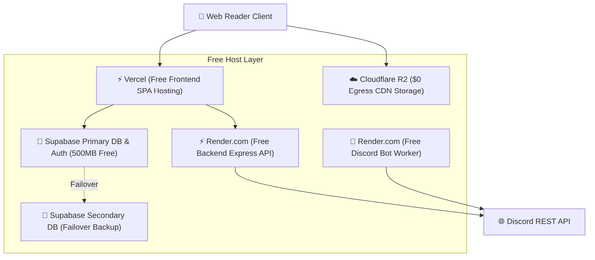

# 🌐 Crystal Comics — 100% Free Production Deployment Manual

> **Platform**: Crystal Comics (`crystal-scans`)  
> **Goal**: Deploy a complete, production-ready manga platform for **$0 hosting cost** with unlimited image bandwidth.

---

## 🏗️ Production Architecture Blueprint



---

## ⚡ 1. Step-by-Step Free Hosting Setup

### Step 1: Database & Auth Setup (Supabase Free Tier)

1. Go to [Supabase](https://supabase.com) and create a **Free Account**.
2. **Create Primary Project**: Name it `crystal-comics-primary` (select your preferred region).
3. **Execute SQL Schema**:
   - Open Supabase Dashboard -> **SQL Editor** -> **New Query**.
   - Copy the entire contents of [`supabase/schema.sql`](file:///D:/Projects/Crystal-Comics/supabase/schema.sql) and paste it into the editor.
   - Click **Run** to generate all PostgreSQL tables, indexes, RLS policies, and user triggers.
4. **Copy API Keys**:
   - Go to Project Settings -> API.
   - Copy `Project URL` and `anon public` key to your `.env` file (`VITE_SUPABASE_URL`, `VITE_SUPABASE_ANON_KEY`).
5. **(Optional) Setup Secondary Failover DB**:
   - Create a second free project `crystal-comics-secondary`.
   - Run the same `supabase/schema.sql` script on it.
   - Copy keys to `VITE_SUPABASE_SECONDARY_URL` and `VITE_SUPABASE_SECONDARY_ANON_KEY`.

---

### Step 2: Zero-Egress Image CDN Setup (Cloudflare R2)

1. Go to [Cloudflare Dashboard](https://dash.cloudflare.com) and create a free account.
2. Open **R2 Object Storage** from the left navigation sidebar.
3. Click **Create Bucket**: Name it `crystal-comics-chapters`.
4. **Configure Custom Public Domain**:
   - In bucket settings -> **Custom Domains** -> Click **Connect Domain**.
   - Enter a subdomain on your domain (e.g. `cdn.yourdomain.com` or use Cloudflare R2's free dev domain `https://pub-xxxx.r2.dev`).
5. **Generate S3 API Credentials**:
   - Go to R2 Overview -> **Manage R2 API Tokens** -> **Create API Token**.
   - Permissions: **Admin Read & Write**.
   - Copy `Account ID`, `Access Key ID`, and `Secret Access Key` to your `.env` file.

---

### Step 3: Discord OAuth & Linked Roles Integration

1. Go to [Discord Developer Portal](https://discord.com/developers/applications) -> **New Application**.
2. **OAuth2 Configuration**:
   - Copy `Client ID` and `Client Secret` to `.env`.
   - Under OAuth2 -> Redirects -> Add:
     - `https://your-domain.vercel.app/`
     - `https://<your-supabase-ref>.supabase.co/auth/v1/callback`
3. **Bot Configuration**:
   - Click **Bot** tab -> Add Bot -> Copy `Bot Token` to `.env`.
   - Enable **"Server Members Intent"** under Privileged Gateway Intents.
4. **Register Linked Roles Metadata**:
   - Run the metadata registration script once locally:
     ```bash
     node scripts/register-discord-linked-roles.js
     ```

---

### Step 4: Deploying Frontend to Vercel (Free)

1. Push your repository code to GitHub.
2. Go to [Vercel Dashboard](https://vercel.com) -> Click **Add New Project**.
3. Import your `crystal-comics` GitHub repository.
4. **Environment Variables**:
   - Add all `VITE_` prefixed variables from your `.env` file:
     - `VITE_SUPABASE_URL`
     - `VITE_SUPABASE_ANON_KEY`
     - `VITE_SUPABASE_SECONDARY_URL`
     - `VITE_SUPABASE_SECONDARY_ANON_KEY`
     - `VITE_CLOUDFLARE_R2_PUBLIC_URL`
     - `VITE_BACKEND_SERVER_URL`
5. Click **Deploy**. Vercel will build and host your frontend on a free SSL global CDN domain!

---

### Step 5: Deploying Express API & Discord Bot to Render.com (Free)

1. Go to [Render.com](https://render.com) and sign up for a free account.
2. **Deploy Express Server**:
   - Click **New +** -> **Web Service**.
   - Connect your `crystal-comics` GitHub repository.
   - Build Command: `npm install`
   - Start Command: `node server/index.js`
   - Add environment variables (`CLOUDFLARE_R2_ACCESS_KEY_ID`, `CLOUDFLARE_R2_SECRET_ACCESS_KEY`, `DISCORD_CLIENT_ID`, `DISCORD_CLIENT_SECRET`, `VITE_SUPABASE_URL`, `VITE_SUPABASE_ANON_KEY`).
   - Click **Create Web Service**.
3. **Deploy Discord Bot**:
   - Click **New +** -> **Background Worker**.
   - Start Command: `npm run bot`
   - Add environment variables (`DISCORD_BOT_TOKEN`, `DISCORD_BASIC_ROLE_ID`).
   - Click **Create Background Worker**.

---

## ⏰ 2. Configuring 24/7 Keep-Alive Automation

Supabase free-tier projects automatically pause after 7 days of zero activity. The template handles this automatically through two methods:

### Method A: Built-in 48-Hour Heartbeat Scheduler
- The Express server (`server/index.js`) automatically starts a background 48-hour heartbeat scheduler (`server/keep-alive-db.js`) on startup. It performs a lightweight count ping against both Primary and Secondary Supabase databases.

### Method B: External Free Cron Ping Service (Recommended Backup)
1. Go to [Cron-Job.org](https://cron-job.org) or [UptimeRobot](https://uptimerobot.com) (both 100% free).
2. Create a new HTTP GET Cron Job:
   - Target URL: `https://your-render-app.onrender.com/api/keep-alive/ping`
   - Schedule: Every 3 days.
3. This guarantees your Supabase databases **never auto-pause**!

---

## 📊 Summary of Free Hosting Limits

| Service | Component | Free Tier Allowance | Egress Bandwidth Cost |
| :--- | :--- | :--- | :--- |
| **Vercel** | Frontend SPA | 100 GB Bandwidth / mo | $0.00 |
| **Cloudflare R2** | Image Storage | 10 GB Storage / Unlimited Read Requests | **$0.00 (Zero Egress)** |
| **Supabase (x2)** | DB & Auth | 500 MB DB / 50k MAU per project | $0.00 |
| **Render.com** | API & Discord Bot | 750 free instance hours / mo | $0.00 |
