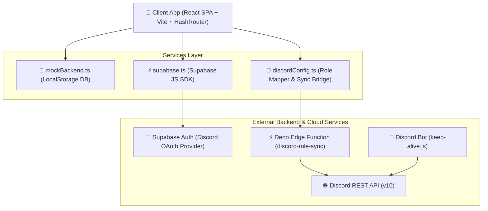

# 🏗️ Crystal Comics — System Architecture & Technical Specification

> **Platform**: Crystal Comics (`crystal-scans`)  
> **Repository Root**: `D:\Projects\Crystal-Comics`  
> **Core Stack**: React 18, TypeScript 5, Vite, Supabase JS v2, Discord.js v14, Deno Edge Functions.

---

## 📐 1. System Overview Architecture



---

## 📂 2. Directory & Module Hierarchy

```
Crystal-Comics/
├── App.tsx               # Root component, HashRouter, ScrollToTop, AuthHandler
├── index.html            # Main HTML document & font loaders
├── index.tsx             # React DOM root render entrypoint
├── package.json          # Dependencies & npm scripts
├── types.ts              # Core TypeScript interfaces & types
├── vite.config.ts        # Vite configuration & dev server options
├── bot/
│   └── keep-alive.js     # Discord.js bot daemon for auto-roles & status presence
├── docs/                 # 📚 Technical Documentation & Specs
│   ├── architecture.md   # System architecture & data flow
│   ├── design.md         # UI/UX design system & tokens
│   ├── memory.md         # Self-contained Architectural Decision Records (ADRs)
│   ├── phases.md         # Multi-phase implementation roadmap
│   └── rules.md          # Engineering standards & coding rules
├── components/
│   ├── Comments.tsx      # User comments & discussion section
│   ├── CrystalAI.tsx     # Gemini AI Manhwa Recommendation Assistant
│   ├── FloatingDock.tsx  # Glassmorphic bottom navigation dock
│   ├── Footer.tsx        # Footer links & copyright bar
│   ├── HeroSlider.tsx    # Trending manga showcase slider
│   ├── Logo.tsx          # Branding crystal logo component
│   ├── MangaCard.tsx    # Vertical manga card component
│   └── QuickSheet.tsx    # Slide-over reader navigation panel
├── pages/
│   ├── Admin.tsx         # Catalog management & Serialized Chapter Panel Uploader
│   ├── Explore.tsx       # Search and multi-filter catalogue page
│   ├── Guild.tsx         # Guild membership & Multi-gateway Payment Portal
│   ├── Home.tsx          # Homepage with sliders & release grids
│   ├── Library.tsx       # User bookmarks and reading history hub
│   ├── Login.tsx         # Supabase Discord OAuth portal
│   ├── MangaDetail.tsx   # Detailed manga info, chapter list & comments
│   ├── Profile.tsx       # User level, rank, XP stats, achievements & Discord identity
│   └── Read.tsx          # Dual-mode reader engine (Vertical Webtoon / Paged Spread)
├── server/
│   ├── config.js         # Server environment configuration loader
│   ├── index.js          # Express API backend server entry point
│   ├── keep-alive-db.js  # Background 48h Supabase keep-alive ping engine
│   └── routes/
│       ├── discord.js    # Discord Linked Roles OAuth code exchange
│       ├── payment.js    # Multi-gateway payment sessions & webhook handler
│       └── storage.js    # Cloudflare R2 presigned upload URL endpoints
├── services/
│   ├── dbService.ts      # Dual-DB failover database adapter
│   ├── discordConfig.ts  # Discord role ID configuration & Edge function invoker
│   ├── discordLinkedRoles.ts # Discord Linked Roles client helper
│   ├── mockBackend.ts    # LocalStorage database, state handlers & API simulation
│   ├── storageService.ts # Cloudflare R2 S3 adapter & natural file sorter
│   └── supabase.ts       # Primary & Secondary Supabase client manager
└── supabase/
    ├── schema.sql        # Full PostgreSQL DDL + RLS security policies
    └── functions/
        └── discord-role-sync/
            └── index.ts  # Deno Edge Function for Discord API role updates
```

---

## 🔐 3. Authentication & State Synchronization Pipeline

### 3.1 OAuth Authentication Flow
1. User clicks **"Login with Discord"** on `pages/Login.tsx`.
2. Supabase Client invokes `supabase.auth.signInWithOAuth({ provider: 'discord' })`.
3. User authorizes the application on Discord's OAuth2 screen.
4. Discord redirects to Supabase OAuth Callback (`https://<project-ref>.supabase.co/auth/v1/callback`), which redirects back to `https://crystal-comics.vercel.app/#/profile`.
5. `AuthHandler` inside `App.tsx` listens via `supabase.auth.onAuthStateChange`:
   - Extracts Discord profile metadata (`full_name`, `avatar_url`, `discord_id`).
   - Hydrates local `User` object merged with existing XP and bookmarks in LocalStorage.
   - Triggers `updateUserProfile(newUser)` to recalculate user tier roles.

---

## 🤖 4. Discord Integration Architecture

### 4.1 Tier Role Synchronization (`discord-role-sync`)
- **Invoker**: `syncRolesWithBot(discordUserId, roleIdsToAdd, guildId)` in `services/discordConfig.ts`.
- **Target**: Supabase Edge Function (`supabase/functions/discord-role-sync/index.ts`).
- **Discord API Request**: `PUT https://discord.com/api/v10/guilds/{guildId}/members/{userId}/roles/{roleId}`
- **Authorization**: `Bot ${DISCORD_BOT_TOKEN}`
- **Role Hierarchy Enforcement**: The Bot's role in Discord Server Settings **must** be ordered above the target tier roles (`Crystal Knight`, `Sovereign`, `Veteran`).

### 4.2 Auto-Role on Member Join (`bot/keep-alive.js`)
- Runs as a standalone Node.js process (`npm run bot`).
- Listens to `Events.GuildMemberAdd` via `discord.js`.
- Automatically grants `DISCORD_BASIC_ROLE_ID` to any user who joins the Discord Guild.

---

## 💾 5. Data Models & TypeScript Interfaces (`types.ts`)

```typescript
export interface Manga {
  id: string;
  title: string;
  coverUrl: string;
  heroUrl?: string;
  rating: number;
  status: 'Ongoing' | 'Completed' | 'Hiatus';
  type: 'Manhwa' | 'Manga' | 'Manhua';
  tags: string[];
  synopsis: string;
  author: string;
  chapters: Chapter[];
  views: string;
  match?: number;
  year?: number;
  rank?: number;
  comments?: Comment[];
}

export interface User {
  id: string;
  username: string;
  role: 'User' | 'Moderator' | 'Admin';
  avatarUrl: string;
  discriminator: string;
  level: number;
  rank: string;
  subscriptionTier: 'Squire' | 'Knight' | 'Sovereign';
  discord: {
    connected: boolean;
    username?: string;
    id?: string;
    roles: string[];
  };
  xp: number;
  maxXp: number;
  joinDate: string;
  bookmarks: string[]; // Manga IDs
  history: HistoryEntry[];
}
```

---

## ☁️ 6. Free Backend & Image Hosting Strategy

To host and serve manga images and backend APIs completely for free with high performance and zero bandwidth fees:

### 6.1 Image Storage & CDN (Free Egress / Free Tier)
1. **Cloudflare R2 (Recommended)**:
   - **Free Allocation**: 10 GB storage per month.
   - **Bandwidth/Egress**: **$0.00 / Unlimited Free Egress** (No egress bandwidth charges).
   - **Integration**: Direct S3-compatible API upload; public CDN domain for serving manga chapter panels fast worldwide.
2. **Supabase Storage (Built-in)**:
   - **Free Allocation**: 1 GB storage + 2 GB bandwidth/month.
   - **Use Case**: Avatars, cover thumbnails, hero banners.

### 6.2 Free Server & API Hosting
1. **Frontend**: Vercel (`crystal-comics.vercel.app`) — Free global CDN & automatic GitHub deployments.
2. **Database & Auth**: Supabase Primary + Secondary PostgreSQL (Free Tier: 500 MB DB, Auth, Realtime).
3. **Bot & Background Worker**: Render.com Free Web Service / Worker or Supabase Edge Functions.
