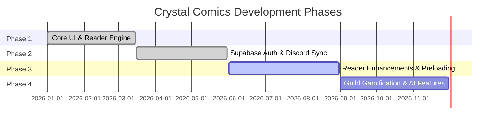

# 🚀 Crystal Comics — Project Phases & Implementation Roadmap

> **Platform**: Crystal Comics (`crystal-scans`)  
> **Repository Root**: `D:\Projects\Crystal-Comics`  
> **Goal**: Build a world-class manhwa/manga reading platform inspired by Asura Scans & Flame Comics.

---

## 📌 Roadmap Overview

---

## 🟢 Phase 1: Core Foundation & UI System (Completed)

- [x] **Project Setup**: Vite + React + TypeScript + Tailwind CSS template initialization.
- [x] **Design Tokens**: Deep obsidian dark palette (`#050508`), glassmorphism card containers (`#0E0E15`), neon purple (`#8B5CF6`) and flame cyan (`#06B6D4`) brand accents.
- [x] **Homepage Components**: `HeroSlider`, `MangaCard` vertical poster layout, latest release list.
- [x] **Explore Page**: Multi-tag filtering (`Action`, `System`, `Fantasy`), status filter (`Ongoing`, `Completed`), search input.
- [x] **Reader Prototype**: Dual-mode reader engine supporting Vertical Continuous Webtoon scroll and Horizontal Paged spreads.
- [x] **Mock Backend**: `mockBackend.ts` handling seed data, LocalStorage persistence for bookmarks and reading history.

---

## 🔵 Phase 2: Supabase Auth & Discord Role Sync (Completed)

- [x] **Supabase Client**: `services/supabase.ts` integration with environment variable checks (`VITE_SUPABASE_URL`, `VITE_SUPABASE_ANON_KEY`).
- [x] **Discord OAuth**: Login portal at [pages/Login.tsx](file:///D:/Projects/Crystal-Comics/pages/Login.tsx) with callback redirect handling in `AuthHandler`.
- [x] **Serverless Edge Function**: `supabase/functions/discord-role-sync/index.ts` deploying Deno function to sync subscription tiers (`Crystal Knight`, `Sovereign`) to Discord Server Role IDs.
- [x] **Discord Bot Daemon**: `bot/keep-alive.js` running `discord.js` client for auto-assigning basic member roles on guild join.

---

## 🟡 Phase 3: Reader Enhancements & Performance (Completed)

- [x] **Image Preloading Engine**: Background preloader for next 3 chapter panels to eliminate image loading delays.
- [x] **Natural Alphanumeric File Sorter**: Automatic sorting (`01.png`, `02.png`, `10.png`) in Admin chapter uploader.
- [x] **Chapter Progress Tracking**: Save reading history and chapter completion state in `user.history`.
- [x] **Bookmark Collections**: Library bookmark manager with reading shelves (`Reading`, `Plan to Read`, `Completed`, `Favorites`).

---

## 🟣 Phase 4: Guild Gamification, Payment Portal & AI (Completed)

- [x] **Discord Identity & Display Name Sync**: Full extraction of Discord Avatar URL, `@username`, and `displayName` across Profile, Header, and Comments.
- [x] **Payment Portal Integration**: Multi-gateway checkout modal (Lemon Squeezy, Stripe, PayPal, Demo Upgrade) on Guild page + server webhook route (`server/routes/payment.js`).
- [x] **XP & Rank Leveling System**: Earn +50 XP per chapter read, level up, and unlock S-Rank gameplay status automatically.
- [x] **Gemini AI Integration**: Interactive manhwa recommendation assistant (`components/CrystalAI.tsx`).
- [x] **Dual-DB Failover & Keep-Alive Engine**: Automated 48h heartbeat scheduler + primary/secondary Supabase connection failover.
